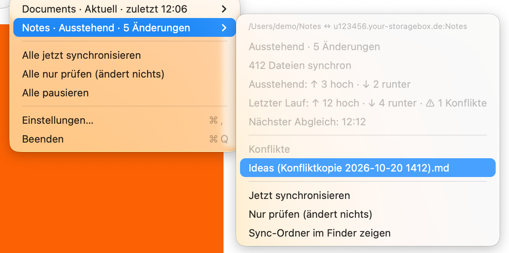
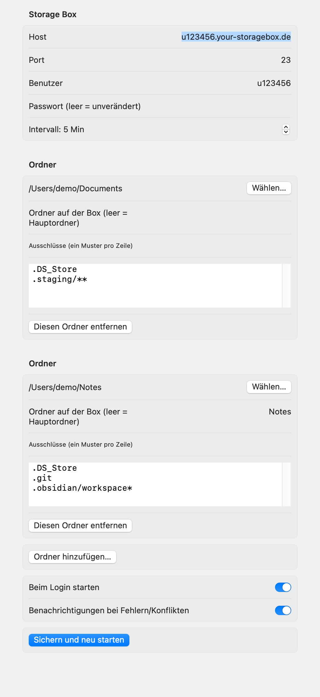

# BoxSync

A native macOS menu bar app that keeps local folders in two-way sync with a
[Hetzner Storage Box](https://www.hetzner.com/storage/storage-box/) over SFTP.
No `rclone`, no mounts, no helper tools: one Swift app, one SFTP connection per run.

<p align="center"></p>

> The app's interface is in German for now. The code, comments and this README are in English.
> BoxSync is an independent project and is not affiliated with Hetzner.

## Why

Mounting a Storage Box as a drive (WebDAV, SSHFS, `rclone mount`, GUI mount tools) can be fragile:
writes may stall or get lost when the connection drops, and caches may go stale. BoxSync does it the boring way: it keeps a real local copy
of each folder, compares it with the Box, and only moves what changed.

## Features

- **Several folder pairs**, each with its own Box folder, exclusions and state. Example: `~/Documents` to the Box root
  and `~/Notes` (an Obsidian vault) to `Notes/`.
- **Two-way merge** with a stored base state per file: a change on one side is copied to the other,
  a change on both sides keeps the newer file and stores the other as `Name (Konfliktkopie YYYY-MM-DD HHMM).ext`.
- **Never deletes for good.** A deletion on one side moves the file to a trash on the other:
  `_trash/<date>/` on the Box, `~/.Trash/BoxSync/<date>/` locally. Overwritten versions go there too.
- **First sync needs your go.** The first run of a folder pair only shows the plan (uploads, downloads, conflicts).
  Nothing moves until you press *Erstabgleich starten*.
- **Check only.** *Nur prüfen* scans both sides and shows what a sync would do, without changing anything.
- **Safe transfers:** atomic uploads through a temp file and rename, resume after an interruption,
  SHA-256 verification, whole-second mtime comparison (SFTP v3), rename detection without re-upload.
- **Mass-delete guard:** a run that would trash a large share of known files at once is stopped.
- **Security:** the password lives in the Keychain only. The host key is pinned on first connect (trust on first use);
  a changed key aborts the connection. Paths coming from the Box are validated so a hostile name cannot leave the sync folder.
- **Unicode aware:** names are compared in NFC, so macOS (NFD) and Linux/iOS (NFC) spellings do not duplicate files.
- Change detection through FSEvents plus a timer (default 5 minutes), launch at login, notifications for errors and conflicts.

<p align="center"></p>

## Requirements

- macOS 14 or newer, Xcode 16+ / Swift 6 toolchain
- A Hetzner Storage Box with SFTP (port 23) and password login

## Build and run

```sh
scripts/build-app.sh          # builds build/BoxSync.app (signed, see "Limits" for the certificate)
open build/BoxSync.app
```

For development: `swift run BoxSyncApp` (no notifications outside an app bundle).

On first start open *Einstellungen…* and enter host (`uXXXXX.your-storagebox.de`), user, password,
and add your folders. The Box folder field maps a local folder to a folder on the Box (empty = Box root).
Exclusions are one pattern per line: `dir/**` (everything below `dir`), a bare name or glob (any path component),
or a glob with `/` (whole relative path).

Never point two sync pairs at overlapping Box folders. If one pair maps the Box root, exclude the other pair's
folder there (for example `Notes/**`).

## Check from the command line

`BoxSyncApp --check` scans every folder pair in check-only mode (nothing is changed on either side), prints a report
and writes it to a file. No menu, no window, no clicks:

```sh
~/Applications/BoxSync.app/Contents/MacOS/BoxSyncApp --check                 # report in ~/Library/Logs/BoxSync/check.txt
~/Applications/BoxSync.app/Contents/MacOS/BoxSyncApp --check --out ~/check.txt
```

Exit code: `0` everything in sync, `1` work pending or an error, `2` the report could not be written.
The command runs inside the app binary so it uses the same Keychain approval as the menu bar app.
It opens its own connection, so it can run while the app is running.

## Tests

```sh
swift test                    # unit tests only, no network
```

The integration tests talk to a real Storage Box. They only create and remove folders under `_boxsync_test/`.
Give them a Box of your own through the environment:

```sh
BOXSYNC_TEST_HOST=uXXXXX.your-storagebox.de BOXSYNC_TEST_USER=uXXXXX BOXSYNC_TEST_PASSWORD=... swift test
```

Without the three variables they are skipped.

## Screenshots with demo data

`BOXSYNC_DEMO=1 build/BoxSync.app/Contents/MacOS/BoxSyncApp` starts the app with invented data that touches neither
disk nor network. That is how the images in `docs/images` were made.

## Using the same folder from an iPhone

An Obsidian vault can be shared with the iPhone through the Remotely Save plugin (WebDAV).
See [docs/obsidian-iphone.md](docs/obsidian-iphone.md).

## Limits

- Password login only (no SSH keys yet). Symlinks and empty folders are not synced.
- No on-demand download or automatic eviction: every folder is a full local copy.
  A File Provider extension (placeholders) is the planned next step; the sync core is UI-free and sits behind the `SyncEngine` protocol.
- Orphaned `.part` files from interrupted uploads are not cleaned up automatically.
- Without a signing certificate, builds are signed ad hoc, so every rebuild is a new app identity for the Keychain.
  macOS then asks for your login Keychain password ("BoxSync wants to use confidential information") after each rebuild.
  Choose *Always Allow*. Until you answer, the app waits at start-up.
  Run `scripts/make-signing-cert.sh` once: it creates a self-signed code-signing certificate "BoxSync Local Signing"
  in your login keychain, and `scripts/build-app.sh` then signs every build with it. The identity stays the same,
  so the prompt appears only once more after the switch. Remove it with
  `security delete-identity -c "BoxSync Local Signing"`.
- Names that differ only in letter case (`Report.md` and `report.md`, also folders) cannot coexist on the default
  case-insensitive macOS volume. BoxSync mirrors one spelling (the one you already have, else the byte-wise first),
  reports the other as an error and never touches or trashes it. Rename it on the Box to bring it down.
  A local case-only rename (`report.md` to `Report.md`) is treated as a new file and leaves the old name on the Box.
- The interface is German only.

## Design

See [ARCHITECTURE.md](ARCHITECTURE.md) (German) for layers, the planner and the state store.
The sync logic is a pure function (`SyncPlanner.plan`) and is unit-tested without a network.

## License

[MIT](LICENSE)
